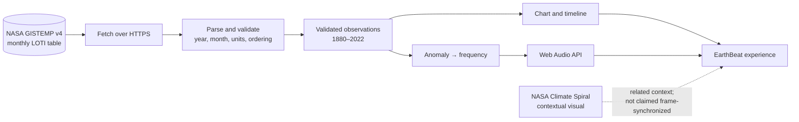

<div align="center">

# EarthBeat 🌍🎵

### Hear the pulse of our planet.

An interactive NASA data-sonification experience that turns monthly global
temperature anomalies into sound.

[](https://react.dev/)
[](https://www.typescriptlang.org/)
[](https://vite.dev/)
[](https://developer.mozilla.org/en-US/docs/Web/API/Web_Audio_API)

**Built for the NASA Space Apps Challenge 2026 challenge
[“The Earth Information Jukebox”](https://www.spaceappschallenge.org/).**

</div>

> EarthBeat is an independent NASA Space Apps Challenge project and is not an
> official NASA product. NASA does not endorse or develop this application.

## Contents

- [Project preview](#project-preview)
- [Why EarthBeat?](#why-earthbeat)
- [How it works](#how-it-works)
- [Features](#features)
- [Architecture](#architecture)
- [Technology stack](#technology-stack)
- [Getting started](#getting-started)
- [Project structure](#project-structure)
- [Data sources and attribution](#data-sources-and-attribution)
- [Scientific methodology and limitations](#scientific-methodology-and-limitations)
- [AI disclosure](#ai-disclosure)
- [Challenge connection](#challenge-connection)
- [Future improvements](#future-improvements)
- [License](#license)
- [Credits](#credits)

## Project preview

The repository currently includes a real, runnable Vite application but no
committed screenshots. Browser navigation permission was unavailable during
the final documentation pass, so no placeholder image is presented as a
product screenshot.

See [`docs/screenshots/README.md`](docs/screenshots/README.md) for the exact
three captures to add when browser access is available.

## Why EarthBeat?

Climate datasets are precise, but a table of anomalies can be difficult to
feel at human scale. EarthBeat offers a second way to encounter the record:
each monthly observation becomes a gentle musical pitch while the user sees
the corresponding position in the timeline and chart.

The experience is designed for the Earth Information Jukebox challenge:
connect a NASA Earth visualization with a dynamic, understandable
sonification—without pretending that the generated audio is a literal sound
recorded from Earth.

## How it works

1. **Fetch** — the browser requests NASA’s official GISTEMP v4 global monthly
   Land-Ocean Temperature Index table.
2. **Parse and validate** — year, month, ordering, numeric values, and NASA’s
   missing-value markers are handled in `src/data/gistemp.ts`.
3. **Limit the experience** — the app uses the 1880–2022 period represented by
   NASA’s referenced Climate Spiral.
4. **Visualize** — the real monthly anomalies drive the chart, date readout,
   timeline, and active marker.
5. **Sonify** — the active anomaly is mapped deterministically to a frequency
   and rendered by the browser’s Web Audio API.

### Anomaly and baseline

A temperature anomaly is a difference from a reference average, not an
absolute temperature. NASA’s GISTEMP table expresses global anomalies in
degrees Celsius relative to the **1951–1980** baseline. NASA marks unavailable
observations with `***`; EarthBeat excludes them rather than substituting
zeros or fabricated values.

### Verified mapping

For anomaly `a`, EarthBeat clamps to `[-1.0, +1.5] °C` and maps linearly to
`[220, 660] Hz`:

```text
frequencyHz = 220 + ((clamp(a, -1.0, 1.5) + 1.0) / 2.5) × 440
```

That means `-1.0 °C → 220 Hz` and `+1.5 °C → 660 Hz`. The full methodology is
documented in [`docs/sonification-method.md`](docs/sonification-method.md).

## Features

- NASA GISTEMP v4 monthly data loaded at runtime.
- Validated 1880–2022 anomaly timeline.
- Interactive monthly anomaly chart and timeline scrubber.
- Deterministic Web Audio API sonification.
- Play, pause, restart, speed, and volume controls.
- Current anomaly and mapped frequency shown as text.
- Official NASA Climate Spiral page embedded as contextual visualization.
- Visible loading, data-error, and browser-audio error states.
- Keyboard-friendly native controls and reduced-motion support.
- NASA attribution and scientific limitations presented in the interface.

## Architecture



Source files and standalone Mermaid diagrams:

- [`docs/architecture.mmd`](docs/architecture.mmd)
- [`docs/data-flow.mmd`](docs/data-flow.mmd)
- [`ARCHITECTURE.md`](ARCHITECTURE.md)

## Technology stack

| Technology | Purpose |
| --- | --- |
| React 18 | Interface and interaction state |
| TypeScript | Typed application and data modules |
| Vite | Development server and production build |
| Recharts | Monthly anomaly chart |
| Lucide React | Interface icons |
| Web Audio API | Runtime oscillator sonification |
| CSS | Responsive visual system and reduced-motion support |

## Getting started

### Prerequisites

- Node.js 20 or newer
- npm 10 or newer
- A modern browser with Web Audio API support
- Network access to NASA’s public data source

### Install and run

```bash
git clone https://github.com/syamjithv/EarthBeat.git
cd EarthBeat
npm install
npm run dev
```

Open the local URL printed by Vite. Audio begins only after pressing **Play**.

### Production build

```bash
npm run build
npm run preview
```

No environment variables, API keys, or backend services are required.

## Project structure

```text
EarthBeat/
├── src/
│   ├── audio/sonification.ts
│   ├── data/gistemp.ts
│   ├── App.tsx
│   ├── main.tsx
│   └── styles.css
├── docs/
│   ├── architecture.mmd
│   ├── data-flow.mmd
│   ├── sonification-method.md
│   └── screenshots/README.md
├── ARCHITECTURE.md
├── ATTRIBUTION.md
├── DATA_SOURCES.md
├── IMPLEMENTATION_PLAN.md
├── PROJECT_BRIEF.md
├── package.json
└── vite.config.ts
```

## Data sources and attribution

- **NASA GISS Surface Temperature Analysis (GISTEMP v4)**  
  [Data landing page](https://data.giss.nasa.gov/gistemp/) ·
  [Documentation](https://data.giss.nasa.gov/gistemp/data_v4.html) ·
  [Global monthly table](https://data.giss.nasa.gov/gistemp/tabledata_v4/GLB.Ts%2BdSST.txt)
- **NASA Scientific Visualization Studio Climate Spiral, SVS 5057**  
  [Visualization page](https://svs.gsfc.nasa.gov/5057/) ·
  [Official metadata API](https://svs.gsfc.nasa.gov/api/5057)
- **NASA Earth Information Center**  
  [Earth Information Center](https://www.nasa.gov/earth-information-center/)

NASA data and visual resources remain NASA resources. EarthBeat adds an
independent interface and generated audio. See [`ATTRIBUTION.md`](ATTRIBUTION.md)
and [`DATA_SOURCES.md`](DATA_SOURCES.md).

## Scientific methodology and limitations

The sound is a creative representation of climate measurements, not sound
recorded from Earth. Higher anomalies produce higher pitches within the
configured listening range; they do not mean that Earth physically emits a
higher-frequency sound.

The GISTEMP source can be revised by NASA, and the app fetches it at runtime.
The experience is limited to 1880–2022 to match the referenced Climate Spiral
version. The NASA visualization is presented as related context; EarthBeat
does not claim exact synchronization between video frames and monthly data.
Network failures and unavailable observations are surfaced instead of replaced
with invented values.

## AI disclosure

GitHub Copilot assisted with application implementation, documentation, and
review during development. Scientific source URLs, units, baseline details,
and numerical mapping values are treated as independently verifiable project
requirements; AI did not generate or substitute NASA observations.

## Challenge connection

NASA’s **The Earth Information Jukebox** challenge asks participants to pair
Earth Information Center visual material with dynamic sonification. EarthBeat
addresses that brief by combining the NASA Climate Spiral context with actual
monthly GISTEMP v4 observations and a deterministic Web Audio API mapping.

## Future improvements

- Verify an official downloadable Climate Spiral asset and add a documented
  frame-to-month synchronization if NASA metadata supports it.
- Add focused automated tests for parser edge cases and playback state.
- Add committed real screenshots once browser capture is available.
- Consider optional local caching while preserving NASA as the source of truth.

## License

No open-source license has been selected yet. Until a license is added, normal
copyright restrictions apply and reuse permissions should not be assumed.

## Credits

Built by the EarthBeat project team for NASA Space Apps Challenge 2026.

- NASA GISS for GISTEMP v4.
- NASA Scientific Visualization Studio for the Climate Spiral.
- NASA Earth Information Center for the challenge context.
- The React, Vite, Recharts, Lucide, and Web Audio API communities.
